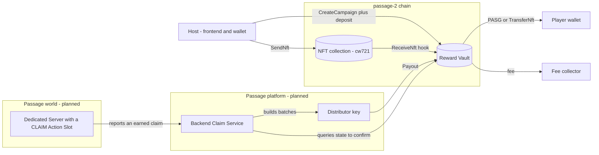
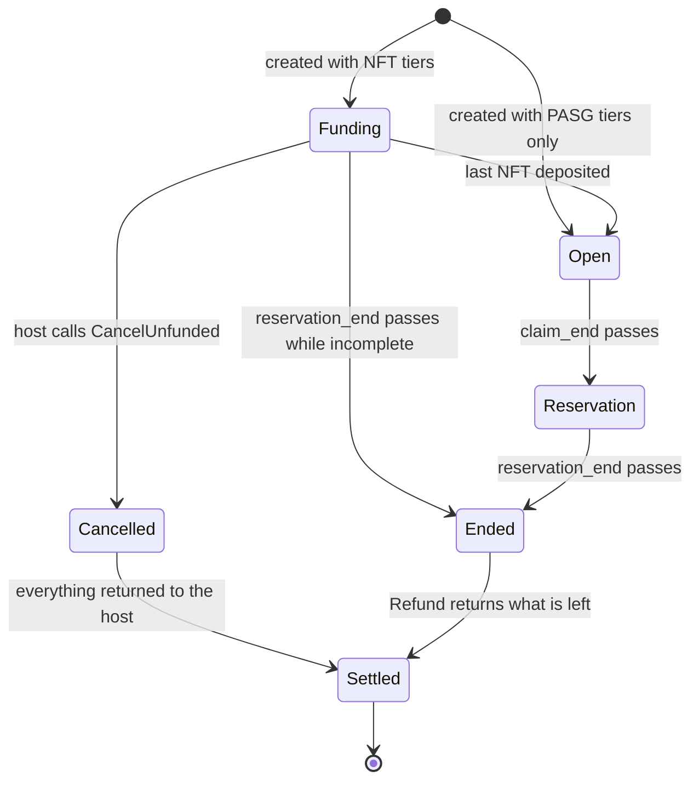
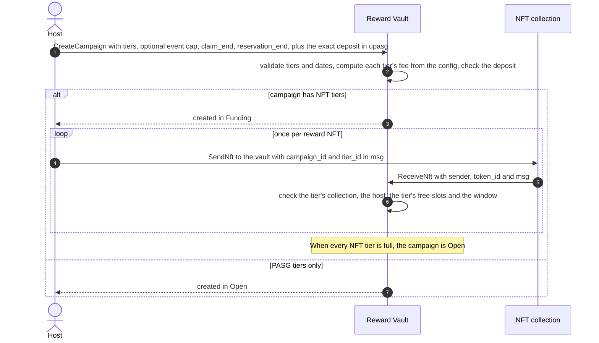
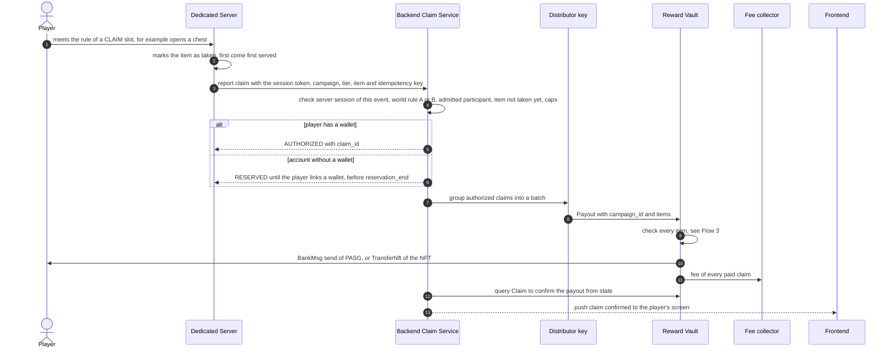
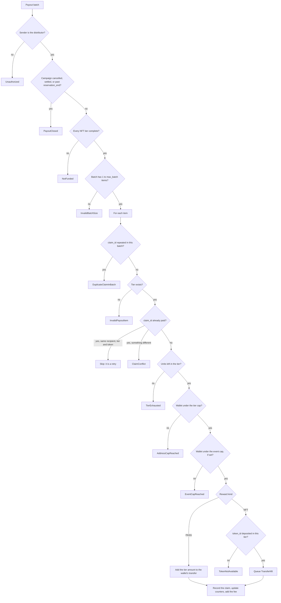
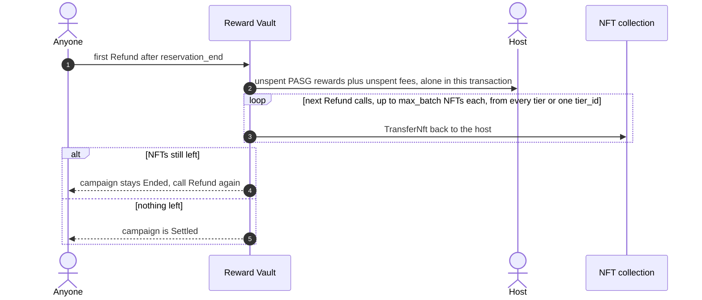
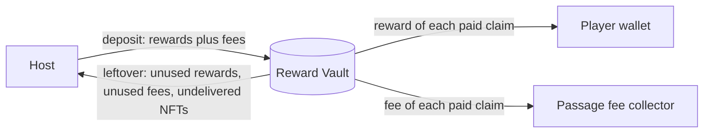

# Reward Vault

Host-funded reward campaigns for Passage events.

A **host** (the person or organization running an event) funds the rewards before the event starts. Players earn those rewards inside a Passage world. Passage's **distributor** pays each earned reward from the vault, and whatever is left goes back to the host when the campaign ends.

> **Status:** prototype for testnet. The contract is implemented and tested locally. It is **not audited and not deployed**. The backend Claim Service, the `CLAIM` Action Slot in the world SDK and the frontend screens are approved designs that are not built yet. They appear in the diagrams as *planned*.

---

## Contents

1. [Concepts](#concepts)
2. [Architecture](#architecture)
3. [Campaign lifecycle](#campaign-lifecycle)
4. [Flow 1: create and fund a campaign](#flow-1-create-and-fund-a-campaign)
5. [Flow 2: a player earns a reward](#flow-2-a-player-earns-a-reward)
6. [Flow 3: payout checks](#flow-3-payout-checks)
7. [Flow 4: settle or cancel](#flow-4-settle-or-cancel)
8. [Where the money goes](#where-the-money-goes)
9. [Fees](#fees)
10. [Message reference](#message-reference)
11. [Errors](#errors)
12. [Security model](#security-model)
13. [Build, test and deploy](#build-test-and-deploy)

---

## Concepts

| Term | Meaning |
|---|---|
| **Campaign** | All the rewards of one event. One campaign per event, identified by its **host and** `campaign_id`. Ids are scoped to the host, so nobody can take another host's id. |
| **Tier** | One kind of prize inside the campaign: a chest, a boss, a sword. Each event defines its own tiers (up to 20). |
| **Reward** | What a tier pays per claim: a fixed amount of PASG, or one pre-minted NFT from a collection. |
| **Claim** | One earned reward, identified by a `claim_id` that the backend assigns. Each claim id can be paid only once. |
| **Tier cap** | How many times one wallet can receive a given tier. Required. |
| **Event cap** | How many prizes one wallet can receive across all tiers of the event. Optional. |
| **Claim window** | Until `claim_end`, players can earn rewards. NFT deposits also close at `claim_end`. |
| **Reservation period** | From `claim_end` to `reservation_end`. Claims reserved for players who had no wallet yet can still be paid. |
| **Distributor** | Passage's key. It is the only address allowed to execute payouts. |
| **Fee collector** | Passage's address that receives the fee of every paid claim. |

### Tiers and caps by example

An event with three kinds of prize and a limit of 4 prizes per wallet:

| Tier | Reward | Units | Tier cap |
|---|---|---|---|
| `chest` | 1 PASG | 50 | 3 |
| `boss` | 10 PASG | 1 | 1 |
| `sword` | 1 NFT from collection X | 5 | 1 |

Event cap: **4**.

- Alice opens 4 chests. She is paid for 3. The fourth is refused by the **tier cap** of `chest`.
- Alice then wins a sword. She now has 4 prizes in total.
- Alice defeats the boss. That prize is refused by the **event cap**, even though the `boss` tier still has its unit.
- Bob defeats the boss and is paid. Nobody else can get the boss: the tier is exhausted.

Both caps count prizes, not value. Neither cap stops someone who controls many wallets; that is the job of the event's access control (guest list or eligibility rules), which lives off-chain.

---

## Architecture



The contract does not know who earned a reward. The backend decides that, using the world's rules and its own session checks. The contract enforces what the host funded: totals, caps, single-use claim ids, time windows, and where money can go.

---

## Campaign lifecycle



| Status | Payouts | NFT deposits | Refund | Cancel |
|---|---|---|---|---|
| `Funding` | no | yes | no | yes (host) |
| `Open` | yes | no | no | no |
| `Reservation` | yes | no | no | no |
| `Ended` | no | no | yes (anyone) | no |
| `Cancelled` | no | no | yes (anyone) | no |
| `Settled` | no | no | no | no |

Notes:
- The status is computed from the block time and the campaign's counters, so it changes without any transaction.
- A campaign whose claims are all paid stays `Open` or `Reservation` until `reservation_end`. Its final refund has nothing to send and just marks it `Settled`.
- There is no manual close. The host cannot end a campaign early, and neither can Passage.

---

## Flow 1: create and fund a campaign



What the host deposits in the `CreateCampaign` transaction:

- for each PASG tier: `max_claims × (amount_per_claim + fee)`;
- for each NFT tier: `max_claims × nft_fee`. The NFTs themselves follow with `SendNft`.

The deposit must match **exactly**, in a single coin of the configured denom. A campaign is either fully funded or not created. No tier pays until every NFT tier holds all its NFTs: the campaign fails closed.

---

## Flow 2: a player earns a reward

Only the vault part of this flow is implemented. The world, backend and frontend parts are the approved design.



The backend confirms payouts by reading the vault's state (`claim` query), not by looking transactions up by hash: the passage-2 node runs with `tx_index` off.

---

## Flow 3: payout checks

Every `Payout` batch goes through these checks. **Any failure rejects the whole batch**; a batch is atomic.



After the loop, the contract sends one bank transfer per recipient, the NFT transfers, and one fee transfer to the fee collector.

**Retries.** If the distributor broadcasts a batch and never sees the confirmation, it can send the same batch again. Claims already paid to the same recipient, tier and token are skipped, so nobody is paid twice. The response reports `paid` and `skipped` counts.

---

## Flow 4: settle or cancel

### Settle after the reservation period



Anyone can trigger the refund, so the host does not need to be online. Funds only ever go to the host. The PASG leftover always travels alone, so a collection that refuses transfers can never block it. NFTs are returned in pages so a large campaign never exceeds the block gas limit, and `tier_id` lets a caller skip a tier whose collection is stuck.

### Cancel an unfunded campaign

While some NFT tier is still incomplete, the host can call `CancelUnfunded` on its own campaign. Nothing can have been paid yet, so no player loses anything. The PASG deposit and all fees come back at once; the NFTs already deposited follow with `Refund`. Once every NFT tier is complete, the campaign can no longer be cancelled.

---

## Where the money goes



Money can only leave the vault towards a claim recipient, the fee collector or the host. The vault holds funds of many campaigns, but each campaign's balance is derived from its own counters, so one campaign can never pay out another campaign's funds.

---

## Fees

The fee is set by Passage in the contract configuration. **The host never sets it.**

- PASG claim: `fee = max(amount_per_claim × fee_bps / 10000, min_fee)`. `min_fee` keeps the fee above the gas cost of paying a small reward.
- NFT claim: `fee = nft_fee`, a fixed amount of PASG per NFT.
- The fee is charged only for claims that are paid. Fees for unused claims go back to the host.
- Each tier keeps a copy of its fee from the moment the campaign is created. If Passage changes the configuration later, funded campaigns keep their original fee.

Worked example for the event above, with an example configuration of `fee_bps = 500` (5 %), `min_fee = 0.1 PASG` and `nft_fee = 0.05 PASG` (the real values are not decided yet):

| Tier | Reward | Fee per claim | Units | Deposit |
|---|---|---|---|---|
| `chest` | 1 PASG | max(0.05, 0.1) = 0.1 PASG | 50 | 50 × 1.1 = 55 PASG |
| `boss` | 10 PASG | max(0.5, 0.1) = 0.5 PASG | 1 | 10.5 PASG |
| `sword` | NFT | 0.05 PASG | 5 | 0.25 PASG + 5 NFTs |
| **Total** | | | | **65.75 PASG + 5 NFTs** |

Amounts on-chain are in `upasg` (1 PASG = 1 000 000 upasg), so the deposit above is `65750000upasg`.

---

## Message reference

All messages are JSON with snake_case names. Amounts are strings in `upasg`. Timestamps are strings in nanoseconds since the Unix epoch. Addresses below are placeholders.

### Instantiate (Passage)

```json
{
  "owner": null,
  "distributor": "pasg1distributor...",
  "fee_collector": "pasg1feecollector...",
  "denom": "upasg",
  "fee_bps": 500,
  "min_fee": "100000",
  "nft_fee": "50000",
  "max_reservation_secs": 2592000,
  "max_claim_window_secs": 7776000,
  "max_batch": 50
}
```

`owner` defaults to the instantiator. `max_reservation_secs` is the platform maximum for the reservation period (30 days above). `max_claim_window_secs` is the platform maximum between creation and `claim_end` (90 days above). `max_batch` limits payout batches and refund pages (1 to 100).

### Create a campaign (host)

```json
{
  "create_campaign": {
    "campaign_id": "evt-2026-11-20",
    "tiers": [
      { "tier_id": "chest", "reward": { "native": { "amount_per_claim": "1000000" } }, "max_claims": 50, "per_address_cap": 3 },
      { "tier_id": "boss",  "reward": { "native": { "amount_per_claim": "10000000" } }, "max_claims": 1,  "per_address_cap": 1 },
      { "tier_id": "sword", "reward": { "nft": { "collection": "pasg1collection..." } }, "max_claims": 5,  "per_address_cap": 1 }
    ],
    "per_address_cap": 4,
    "claim_end": "1763683200000000000",
    "reservation_end": "1764288000000000000"
  }
}
```

Sent with funds `65750000upasg`. Rules: `campaign_id` has 1 to 64 characters from `[A-Za-z0-9_-]`; `tier_id` has 1 to 32 from the same set and is unique in the campaign; `per_address_cap` of a tier is between 1 and its `max_claims`; the event `per_address_cap` is optional and at least 1 when set; `claim_end` is in the future and at most `max_claim_window_secs` away; `reservation_end - claim_end` is at most `max_reservation_secs`; the collection of an NFT tier must be a contract.

### Deposit an NFT (host, on the collection)

```json
{
  "send_nft": {
    "contract": "pasg1vault...",
    "token_id": "42",
    "msg": "eyJjYW1wYWlnbl9pZCI6ImV2dC0yMDI2LTExLTIwIiwidGllcl9pZCI6InN3b3JkIn0="
  }
}
```

`msg` is the base64 of `{"campaign_id":"evt-2026-11-20","tier_id":"sword"}`. The collection then calls the vault's `receive_nft` hook. The deposit always goes to the sender's own campaign, so only the host can fund it.

### Pay claims (distributor)

```json
{
  "payout": {
    "host": "pasg1host...",
    "campaign_id": "evt-2026-11-20",
    "items": [
      { "claim_id": "clm_0001", "tier_id": "chest", "recipient": "pasg1alice...", "token_id": null },
      { "claim_id": "clm_0002", "tier_id": "sword", "recipient": "pasg1alice...", "token_id": "42" }
    ]
  }
}
```

`token_id` is required for NFT tiers and must be null for PASG tiers. The amount always comes from the tier. A recipient can never be the vault itself.

### Refund and cancel

```json
{ "refund": { "host": "pasg1host...", "campaign_id": "evt-2026-11-20", "tier_id": null } }
```

The first call returns the PASG leftover; later calls return NFTs, from every tier or only from `tier_id`.

```json
{ "cancel_unfunded": { "campaign_id": "evt-2026-11-20" } }
```

### Update the configuration (owner)

```json
{
  "update_config": {
    "owner": null, "distributor": null, "fee_collector": null,
    "fee_bps": 400, "min_fee": null, "nft_fee": null,
    "max_reservation_secs": null, "max_batch": null
  }
}
```

Every field is optional. Funded campaigns keep their fee snapshot.

### Queries

| Query | Returns |
|---|---|
| `{"config": {}}` | The platform configuration. |
| `{"campaign": {"host": "...", "campaign_id": "..."}}` | The campaign, its status, remaining claims, rewards and fees, and a summary per tier. |
| `{"campaigns": {"host": "...", "start_after": null, "limit": 30}}` | One host's campaigns in id order, paginated (maximum 100 per page). |
| `{"claim": {"host": "...", "campaign_id": "...", "claim_id": "..."}}` | The paid claim (tier, recipient, amount or token, fee, time), or null. Used to confirm payouts. |
| `{"address_claims": {"host": "...", "campaign_id": "...", "address": "..."}}` | Prizes paid to a wallet: total and per tier. |
| `{"campaign_nfts": {"host": "...", "campaign_id": "...", "tier_id": "...", "start_after": null, "limit": 30}}` | NFTs still held for a tier. |

### Events

Every execute message emits a `wasm` event with `action` (`create_campaign`, `receive_nft`, `payout`, `refund`, `cancel_unfunded`, `update_config`), the `campaign_id` and its counters, so an indexer can follow deposits, payouts and refunds.

---

## Errors

| Error | When |
|---|---|
| `Unauthorized` | A payout not sent by the distributor, a cancel not sent by the host, or a config update not sent by the owner. |
| `InvalidConfig` | Instantiate or update with an empty denom, `fee_bps` above 10000, a zero reservation maximum, or `max_batch` outside 1 to 100. |
| `InvalidCampaignId`, `InvalidCampaign`, `InvalidTier` | A campaign or tier that breaks the creation rules. The message says which rule. |
| `CampaignExists`, `CampaignNotFound`, `UnknownTier` | Duplicate campaign id, missing campaign, or an NFT deposit for a tier that does not exist. |
| `WrongDeposit`, `Payment` | The deposit is not exactly what the tiers require, uses another denom, or is missing. |
| `NftDepositClosed` | NFT deposit after `claim_end`, or into a cancelled or settled campaign. |
| `WrongCollection`, `TierFull` | NFT from another collection, or into a tier that already holds all its NFTs. A deposit or cancel by someone who is not the host finds no campaign (`CampaignNotFound`). |
| `NotFunded` | Payout while some NFT tier is incomplete. |
| `PayoutClosed` | Payout after `reservation_end`, or into a cancelled or settled campaign. |
| `InvalidBatchSize` | Empty batch, or more than `max_batch` items. |
| `DuplicateClaimInBatch`, `ClaimConflict` | The same claim id twice in a batch, or a claim id already paid to someone else. |
| `TierExhausted`, `AddressCapReached`, `EventCapReached` | No units left in the tier, the wallet reached the tier cap, or the wallet reached the event cap. |
| `InvalidPayoutItem`, `TokenNotAvailable` | Unknown tier, bad claim id, a token id where it does not belong or missing where required, or an NFT not held by that tier. |
| `RefundTooEarly`, `AlreadySettled`, `CannotCancel` | Refund before `reservation_end`, a second refund of a settled campaign, or a cancel of a funded campaign. |

---

## Security model

What the contract guarantees on-chain:

- A campaign only exists if it is fully funded, and it does not pay until every NFT tier is complete.
- The distributor cannot choose amounts: each claim pays the amount of its tier.
- Totals, tier caps and the event cap hold even inside a single batch.
- A claim id is paid at most once.
- Money only leaves towards a claim recipient, the fee collector or the host.
- The fee is set by Passage, and a funded campaign keeps its fee.

What it trusts:

| Trust | Why it matters | Mitigation |
|---|---|---|
| **Distributor key** | It can pay any funded campaign to any wallets, within the caps. | Real custody (KMS or HSM) and monitoring before mainnet. |
| **Owner and wasm admin** | The owner can change the distributor; the wasm admin can migrate the code. | Single key on testnet. Before mainnet: on-chain multisig or no admin. |
| **NFT collection** | The host chooses it; it must be a contract. A malicious contract could fake deposits, but only in that host's own campaign, and a collection that refuses transfers cannot lock the PASG leftover or other tiers. | The backend only accepts Passage collections. |
| **Backend authorization** | The contract does not know who earned a claim. | Session checks, world rules A and B, idempotency and pre-checks of the caps in the backend. |

---

## Build, test and deploy

```sh
cargo test
cargo clippy --all-targets -- -D warnings
cargo build --release --lib --target wasm32-unknown-unknown
```

- **CosmWasm 1.5.** passage-2 runs wasmd v0.50.0 with wasmvm v1.5.0, and an upgrade to wasmvm v2.2.9 is planned. This crate uses `cosmwasm-std` 1.5: it exports `interface_version_8`, which wasmvm 1.5 and 2.x both accept, so the same code works before and after the upgrade. Moving to `cosmwasm-std` 2.x would only work after it. Re-measure the gas of `payout` after the upgrade before setting `min_fee`.
- **Standalone crate.** The root `Cargo.toml` excludes it on purpose: the root pins `cosmwasm-std` 1.0.0-beta7, and joining would re-resolve the shared `Cargo.lock` of every existing contract. The crate has no `[workspace]` table, so `cosmwasm/optimizer` builds it directly from its folder.
- **Cargo 1.83.** `Cargo.lock` pins `base64ct` 1.7.3 and `zeroize` 1.8.1, because their newest releases need Cargo with edition 2024. A newer toolchain does not need these pins.
- **Wasm for the chain.** Build the release artifact with `cosmwasm/optimizer` and check it with `cosmwasm-check` before uploading. A plain `cargo build` with a recent Rust can emit Wasm features that wasmvm 1.5 may reject (not verified).
- **Upload.** On passage-2 only three addresses can upload and instantiate code. On the new testnet, use whichever permissions it ends up with.
- **Tests.** 25 multi-test cases cover the PASG and NFT lifecycles, an event with three tiers and both caps, retries, validation, cancellation, paginated refunds, config changes, migration, a frozen collection, host-scoped ids, payouts to the vault, the claim window limit, wallet collections, zero NFT fee, wrong denom, batch limits, exact time boundaries, isolation between campaigns and a distributor change.
